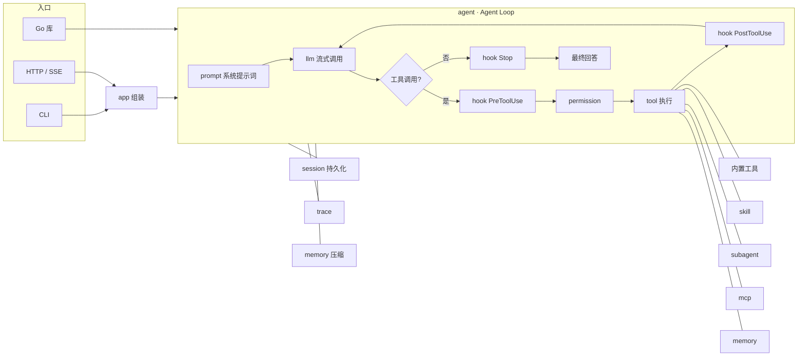

# goagent

**用 Go 从零实现的工业级 AI Agent 框架**：一个能读写代码、执行命令、调用 MCP 工具、委派子任务的编程 Agent，
同时也是一套可嵌入你自己程序的 Agent 开发库。**只依赖 Go 标准库**，单个二进制即可运行。

goagent 是中文 Go 学习平台「Agent 框架专栏」的配套项目：教程带你一步步实现其中的每个模块，
本仓库是最终的完整实现（见文末[配套教程](#配套教程)）。

```text
$ goagent
GoAgent v0.1.0  模型 deepseek-chat · 14 个工具 · 2 个技能 · 权限 default
› 给 config 包补充表驱动测试，并确保 go test 通过
⏺ todo_write (…)
⏺ read_file (config/config.go)
  ⎿      1	// Package config 负责加载 GoAgent 的配置。 …（共 330 行）
⏺ write_file (config/config_test.go)
? 允许调用 write_file？ (config/config_test.go)
  [y] 允许  [a] 本会话总是允许  [n] 拒绝 > a
⏺ bash (go test ./config/)
  ⎿ ok  github.com/dmxj/goagent/config 0.412s
已为 config 包新增 8 组测试用例，全部通过。
── 6 轮 · 累计输入 48213 / 输出 3920 tokens
```

## 特性

| 能力 | 说明 |
| --- | --- |
| **Agent Loop** | 流式调用模型 → 解析工具调用 → 钩子与权限 → 执行 → 回填结果，直到给出最终回答；支持最大轮数、取消、运行中插话（steer） |
| **多 Provider** | Anthropic Messages API 与 OpenAI 兼容协议：Claude、DeepSeek、通义千问、Kimi、智谱 GLM、Ollama、vLLM、one-api 等网关 |
| **流式输出** | 文本、思考过程、工具参数全部增量推送；指数退避重试，已输出内容后不重试 |
| **工具系统** | `tool.Func` 泛型定义工具，参数结构体自动生成 JSON Schema；9 个内置工具；只读工具自动并行 |
| **权限控制** | `default` / `accept_edits` / `plan` / `bypass` 四种模式 + `allow` / `ask` / `deny` 规则，终端与 Web 审批 |
| **Hooks** | 7 个生命周期事件，Go 函数或 shell 命令，可阻止调用、改写参数、补充上下文、要求继续工作 |
| **记忆与压缩** | AGENTS.md 项目指令、跨会话长期记忆、会话持久化与断点续聊、超长上下文自动压缩 |
| **Skills** | 兼容 Anthropic Agent Skills 规范，渐进式加载，几十个 token 挂载任意多技能 |
| **子 Agent** | `task` 工具委派任务：独立上下文、工具过滤、并行执行，支持 Markdown 自定义 |
| **MCP** | stdio 与 Streamable HTTP 客户端，配置与 Claude Code 兼容；附带编写 MCP 服务器的工具 |
| **Trace** | 树状 Span 记录每次模型调用与工具执行的耗时、token、输入输出，JSONL 落盘，终端树形查看 |
| **HTTP / SSE** | `goagent serve` 提供 REST + SSE 接口与内置 Web 界面（含审批弹窗），可嵌入你自己的服务 |
| **CLI** | 交互式 REPL 与斜杠命令、非交互 `run`（可输出 JSONL 事件，适合脚本与 CI） |
| **零依赖** | 只用标准库：SSE、JSON Schema、frontmatter、MCP 协议都是自己实现的，代码全部可读 |

## 架构



各模块职责、事件模型与设计取舍详见 [docs/ARCHITECTURE.md](docs/ARCHITECTURE.md)。

## 目录结构

```text
goagent/
├── agent/              # Agent Loop 核心循环、事件模型
├── llm/                # 模型抽象：消息、流式事件、Anthropic / OpenAI Provider、SSE、重试、Mock
├── tool/               # 工具接口、注册表、tool.Func 泛型工具、JSON Schema 生成
│   └── builtin/        # 内置工具：文件读写编辑、目录、glob、grep、bash、web_fetch、todo_write
├── permission/         # 权限模式、规则匹配、审批
├── hook/               # 生命周期钩子（Go 函数 / shell 命令）
├── session/            # 会话历史与持久化
├── memory/             # 项目指令（AGENTS.md）、长期记忆、上下文压缩
├── skill/              # Skills 技能发现与加载
├── subagent/           # 子 Agent 定义与 task 工具
├── mcp/                # MCP 客户端（stdio / HTTP）与极简服务器
├── trace/              # Span、导出器、树形渲染
├── prompt/             # 系统提示词组装
├── config/             # 分层配置加载
├── app/                # 依赖组装（CLI 与 HTTP 服务共用）
├── server/             # HTTP API、SSE、Web 审批、内置界面（web/index.html）
├── cmd/goagent/        # 命令行入口
├── internal/           # frontmatter 解析、跨平台子进程管理
├── examples/           # 可运行的示例
├── docs/               # 架构文档
├── .goagent/           # 示例配置、技能、子 Agent（运行时数据也写在这里，已被 .gitignore 忽略）
└── AGENTS.md           # 本项目的开发约定（同时演示项目指令功能）
```

## 快速开始

### 安装

需要 Go 1.24 及以上。

```bash
go install github.com/dmxj/goagent/cmd/goagent@latest
```

国内网络建议先设置模块代理：

```bash
go env -w GOPROXY=https://goproxy.cn,direct
```

或者从源码构建：

```bash
git clone https://github.com/dmxj/goagent.git
cd goagent
make build          # 生成 bin/goagent
./bin/goagent version
```

也可以使用 Docker（构建阶段已配置 goproxy.cn 镜像）：

```bash
docker build -t goagent .
docker run --rm -it -p 8787:8787 -v "$PWD":/workspace \
  -e GOAGENT_API_KEY=sk-xxx -e GOAGENT_SERVER_TOKEN=换成随机字符串 goagent
```

### 配置模型并运行

最简单的方式是环境变量：

```bash
# Anthropic Claude（也适用于兼容 Anthropic 协议的中转网关）
export GOAGENT_API_KEY=sk-ant-xxx
export GOAGENT_MODEL=claude-sonnet-4-5

# 或者 DeepSeek 等 OpenAI 兼容服务
export GOAGENT_PROVIDER=openai
export GOAGENT_BASE_URL=https://api.deepseek.com/v1
export GOAGENT_API_KEY=sk-xxx
export GOAGENT_MODEL=deepseek-chat

goagent                                  # 交互式对话
goagent run -p "总结一下这个仓库的结构"     # 执行一次任务后退出
goagent serve                            # 启动 HTTP 服务，浏览器打开 http://127.0.0.1:8787
```

已经配置好 Claude Code 的用户无需任何配置：goagent 会自动读取 `~/.claude/settings.json` 中的
`ANTHROPIC_BASE_URL`、`ANTHROPIC_AUTH_TOKEN` 与模型名（见[从 Claude Code 导入](#从-claude-code-导入)）。

没有 API Key 也能体验：`GOAGENT_PROVIDER=mock goagent` 使用会复述输入的离线模型。

## 配置

### 加载顺序

配置分层合并，后者覆盖前者（只覆盖文件中出现的字段）：

1. 内置默认值
2. `~/.claude/settings.json`（Claude Code 配置，仅导入模型连接信息）
3. `~/.goagent/config.json`（用户级）
4. `<工作目录>/.goagent/config.json`（项目级）
5. 环境变量
6. 命令行参数（`-model`、`-profile`、`-mode`）

`goagent config` 可以查看最终生效的配置及其来源（密钥已脱敏）。

### config.json 全字段示例

完整可用的示例见 [`.goagent/config.example.json`](.goagent/config.example.json)，复制为 `.goagent/config.json` 后按需修改。
字符串中的 `${VAR}` 会展开为环境变量（适用于 `provider` 与 `profiles` 的 `base_url` / `api_key` / `headers`，
以及 MCP 服务器的 `command` / `args` / `url` / `env` / `headers`），**推荐把密钥留在环境变量里**。

```json
{
  "provider": { "type": "anthropic", "base_url": "https://api.anthropic.com", "api_key": "${ANTHROPIC_API_KEY}", "headers": {}, "retries": 4 },
  "model": "claude-sonnet-4-5",
  "max_tokens": 8192,
  "temperature": 0.2,
  "thinking_budget": 0,
  "context_window": 200000,
  "max_turns": 60,
  "profiles": {
    "deepseek": { "provider": { "type": "openai", "base_url": "https://api.deepseek.com/v1", "api_key": "${DEEPSEEK_API_KEY}" }, "model": "deepseek-chat", "context_window": 64000 }
  },
  "permissions": {
    "mode": "default",
    "allow": ["bash(go test:*)", "web_fetch(domain:pkg.go.dev)"],
    "ask": ["write_file(go.mod)"],
    "deny": ["bash(rm -rf:*)", "bash(git push:*)"]
  },
  "hooks": {
    "PostToolUse": [{ "matcher": "write_file|edit_file", "command": "gofmt -l .", "timeout": 30 }]
  },
  "mcp_servers": {
    "github": { "type": "http", "url": "https://api.githubcopilot.com/mcp/", "headers": { "Authorization": "Bearer ${GITHUB_TOKEN}" } },
    "demo": { "command": "go", "args": ["run", "./examples/mcp-server"] }
  },
  "tools": { "disabled": ["web_fetch"], "restrict_to_workdir": true, "require_read_before_edit": true, "bash_timeout_sec": 120 },
  "memory": { "enabled": true },
  "compact": { "enabled": true, "threshold": 0.8, "keep_recent": 2 },
  "trace": { "enabled": true },
  "system_prompt_append": "回答时附上相关文件路径。"
}
```

| 字段 | 默认值 | 说明 |
| --- | --- | --- |
| `provider.type` | `anthropic` | `anthropic`（别名 `claude`）、`openai`（别名 `openai-compatible` / `deepseek` / `qwen` / `ollama`）、`mock` |
| `provider.base_url` | 官方地址 | OpenAI 兼容服务需包含 `/v1` 等版本前缀 |
| `provider.retries` | `0`（默认 4 次） | 最大尝试次数；负数表示不重试 |
| `model` | `claude-sonnet-4-5` | 模型名；`deepseek-v4[1m]` 这类 Claude Code 风格的后缀会被自动去掉 |
| `max_tokens` | `8192` | 单次回复的最大输出 token |
| `thinking_budget` | `0` | 大于 0 时开启 Anthropic 扩展思考 |
| `context_window` | `128000` | 模型上下文窗口，用于判断何时压缩 |
| `max_turns` | `60` | 单次任务调用模型的最大轮数 |
| `profiles` | — | 命名模型配置，用 `-profile 名称` 或 `/model 名称` 切换 |
| `permissions` | `default` 模式 | 见[权限](#权限) |
| `hooks` | — | 见 [Hooks](#hooks) |
| `mcp_servers` | — | 见 [MCP](#mcp) |
| `tools.disabled` | — | 禁用的工具名 |
| `tools.restrict_to_workdir` | `true` | 文件工具只能访问工作目录内的路径 |
| `tools.require_read_before_edit` | `true` | 修改已有文件前必须先 `read_file` |
| `tools.bash_timeout_sec` | `120` | bash 默认超时 |
| `memory.enabled` | `true` | 长期记忆（`memory_*` 工具，存放在 `.goagent/memory/`） |
| `compact.enabled` / `threshold` / `keep_recent` | `true` / `0.8` / `2` | 自动压缩：超过窗口 80% 时压缩，保留最近 2 轮用户输入 |
| `trace.enabled` | `true` | 把 Trace 写入 `.goagent/traces/日期.jsonl` |
| `system_prompt_append` | — | 追加到系统提示词末尾的内容 |

### 环境变量

| 变量 | 说明 |
| --- | --- |
| `GOAGENT_PROVIDER` | Provider 类型 |
| `GOAGENT_BASE_URL` | 服务地址 |
| `GOAGENT_API_KEY` | API Key |
| `GOAGENT_MODEL` | 模型名 |
| `GOAGENT_PERMISSION_MODE` | 权限模式 |
| `GOAGENT_MAX_TURNS` | 最大轮数 |
| `ANTHROPIC_AUTH_TOKEN` / `ANTHROPIC_API_KEY` / `ANTHROPIC_BASE_URL` | 未设置 `GOAGENT_API_KEY` 且 Provider 为 anthropic 时使用 |
| `OPENAI_API_KEY` / `DEEPSEEK_API_KEY` / `DASHSCOPE_API_KEY` / `OPENAI_BASE_URL` | 未设置 `GOAGENT_API_KEY` 且 Provider 为 openai 时使用 |
| `GOAGENT_NO_CLAUDE_SETTINGS` | 设为任意值时不导入 `~/.claude/settings.json` |
| `GOAGENT_ADDR` | `serve` 的监听地址，默认 `127.0.0.1:8787` |
| `GOAGENT_SERVER_TOKEN` | `serve` 的访问令牌 |
| `NO_COLOR` | 关闭终端颜色 |

bash 工具执行的命令中会带上 `GOAGENT=1`，脚本可以据此判断自己是否运行在 Agent 中。

### 从 Claude Code 导入

如果 `~/.claude/settings.json` 的 `env` 中配置了 `ANTHROPIC_AUTH_TOKEN`（或 `ANTHROPIC_API_KEY`），
goagent 会把它与 `ANTHROPIC_BASE_URL`、模型名（`model` → `ANTHROPIC_MODEL` → `ANTHROPIC_DEFAULT_SONNET_MODEL`）
作为默认的模型配置。很多国内网关（如智谱、Kimi、DeepSeek 提供的 Anthropic 兼容入口）都通过这种方式接入 Claude Code，
goagent 可以直接复用。用户级、项目级配置与环境变量仍然可以覆盖导入的值；设置 `GOAGENT_NO_CLAUDE_SETTINGS=1` 可关闭导入。

### OpenAI 兼容服务示例

以下片段放进 `profiles` 后用 `goagent -profile 名称` 启动，或直接作为顶层 `provider` + `model` 使用：

```json
{
  "profiles": {
    "deepseek": {
      "provider": { "type": "openai", "base_url": "https://api.deepseek.com/v1", "api_key": "${DEEPSEEK_API_KEY}" },
      "model": "deepseek-chat", "context_window": 64000
    },
    "qwen": {
      "provider": { "type": "openai", "base_url": "https://dashscope.aliyuncs.com/compatible-mode/v1", "api_key": "${DASHSCOPE_API_KEY}" },
      "model": "qwen-plus", "context_window": 128000
    },
    "kimi": {
      "provider": { "type": "openai", "base_url": "https://api.moonshot.cn/v1", "api_key": "${MOONSHOT_API_KEY}" },
      "model": "kimi-k2-0905-preview", "context_window": 256000
    },
    "glm": {
      "provider": { "type": "openai", "base_url": "https://open.bigmodel.cn/api/paas/v4", "api_key": "${ZHIPU_API_KEY}" },
      "model": "glm-4.6", "context_window": 128000
    },
    "ollama": {
      "provider": { "type": "openai", "base_url": "http://localhost:11434/v1" },
      "model": "qwen2.5-coder:7b", "context_window": 32000, "max_tokens": 4096
    }
  }
}
```

说明：

- 模型名与上下文长度以各厂商文档为准，上面只是示例。
- DeepSeek 等模型返回的 `reasoning_content` 会作为思考过程流式展示。
- 本地服务（`localhost` / `127.0.0.1`）不需要 API Key。
- 工具调用能力较弱的小模型可能无法稳定完成多步任务，建议先用 `-mode plan` 观察其行为。

## CLI 用法

```text
goagent [chat]            交互式对话（默认）
goagent run -p "任务"      执行一次任务后退出；也可以 echo "任务" | goagent run
goagent serve             启动 HTTP 服务（默认 127.0.0.1:8787）
goagent trace [文件]       以树形查看 trace（默认最新的 .goagent/traces/*.jsonl）
goagent sessions          列出历史会话
goagent config            查看生效的配置（密钥已脱敏）
goagent version | help
```

通用参数：

| 参数 | 说明 |
| --- | --- |
| `-dir 路径` | 工作目录（默认当前目录） |
| `-model 名称` | 覆盖模型名 |
| `-profile 名称` | 使用 `profiles` 中的命名配置 |
| `-mode 模式` | 权限模式：`default` / `accept_edits` / `plan` / `bypass` |
| `-resume 会话ID` | 恢复指定会话继续对话 |
| `-v` | （chat）显示子 Agent 的详细输出 |
| `-json` | （run）以 JSONL 输出全部事件，便于脚本处理 |
| `-addr` / `-token` | （serve）监听地址与访问令牌 |

`run` 子命令下需要审批的调用会被自动拒绝（适合 CI），可以配合 `-mode accept_edits` 或 `allow` 规则使用：

```bash
goagent run -mode accept_edits -p "修复 go vet 报告的问题" -json | jq -r 'select(.type=="tool_call") | .tool.name'
```

交互模式下按 `Ctrl+C` 中断当前任务（不会退出程序），输入 `/exit` 或 `Ctrl+D` 退出。

### 斜杠命令

| 命令 | 说明 |
| --- | --- |
| `/help` | 查看命令列表 |
| `/new`（`/clear`） | 开始新会话 |
| `/resume <id>` | 恢复会话 |
| `/sessions` | 会话列表 |
| `/compact` | 手动压缩上下文 |
| `/model [名称]` | 查看 / 切换模型（名称可以是 profile 名） |
| `/mode [模式]` | 查看 / 切换权限模式 |
| `/tools`、`/skills`、`/agents` | 列出工具、技能、子 Agent |
| `/memory` | 查看长期记忆索引 |
| `/trace` | 以树形查看本会话的 trace |
| `/files` | 本会话访问过的文件 |
| `/usage` | token 用量 |
| `/exit`（`/quit`） | 退出 |

## HTTP API

`goagent serve` 启动服务后，浏览器打开根路径即可使用内置 Web 界面（流式输出、工具过程、审批弹窗）。
设置了令牌时，所有 `/v1/*` 请求都需要请求头 `Authorization: Bearer <令牌>`；Web 界面通过 `http://地址/?token=<令牌>` 打开一次即可。

> **安全提示**：Agent 可以执行任意命令。服务默认只监听 `127.0.0.1`；监听其它地址时务必设置 `-token`
> （或 `GOAGENT_SERVER_TOKEN`），并考虑在容器等隔离环境中运行。CORS 允许任意来源，依赖令牌做鉴权。

| 方法 | 路径 | 说明 |
| --- | --- | --- |
| `GET` | `/health` | 健康检查（无需令牌）：`{"status":"ok","version":"..."}` |
| `GET` | `/v1/info` | 模型、工具、技能、子 Agent、MCP 服务器、权限模式、配置来源与警告 |
| `POST` | `/v1/chat` | 运行一轮对话，**SSE** 推送事件。请求体 `{"session_id":"可选","message":"..."}` |
| `GET` | `/v1/sessions` | 会话列表 |
| `POST` | `/v1/sessions` | 新建会话，返回 `{"id":"..."}` |
| `GET` | `/v1/sessions/{id}` | 会话详情：消息、用量、摘要、是否运行中 |
| `DELETE` | `/v1/sessions/{id}` | 删除会话 |
| `POST` | `/v1/sessions/{id}/cancel` | 取消正在运行的任务 |
| `POST` | `/v1/sessions/{id}/steer` | 运行中追加一条用户消息 `{"message":"..."}`，在下一次调用模型前送达 |
| `POST` | `/v1/sessions/{id}/compact` | 手动压缩上下文 |
| `GET` | `/v1/sessions/{id}/files` | 本会话访问过的文件 |
| `GET` | `/v1/sessions/{id}/todos` | 本会话的待办清单 |
| `POST` | `/v1/permissions/{id}` | 提交审批结果 `{"allow":true,"remember":false}` |
| `GET` | `/v1/traces` | 查询 Span，可选 `?trace_id=` 或 `?session_id=` |
| `GET` | `/v1/traces/{id}/tree` | 纯文本树形 trace |

同一会话正在运行时再次调用 `/v1/chat` 返回 `409`；客户端断开连接会取消运行。

```bash
curl -N http://127.0.0.1:8787/v1/chat -H 'Content-Type: application/json' \
  -d '{"message":"列出当前目录的 Go 文件"}'
```

```text
event: session
data: {"session_id":"20261027-153000-a1b2c3"}

event: text_delta
data: {"type":"text_delta","agent":"main","session_id":"20261027-153000-a1b2c3","turn":1,"text":"我来","time":"..."}

event: tool_call
data: {"type":"tool_call","agent":"main","turn":1,"tool":{"id":"toolu_01","name":"glob","input":{"pattern":"**/*.go"}}, ...}

...

event: run_end
data: {"type":"run_end","agent":"main","text":"共有 42 个 Go 文件……","usage":{"input_tokens":5120,"output_tokens":310},"data":{"turns":2,"stop_reason":"end_turn","trace_id":"..."}, ...}

event: done
data: {"session_id":"20261027-153000-a1b2c3"}
```

### SSE 事件类型

每个 SSE 事件的 `event:` 字段即事件类型，`data:` 是 JSON。除 `session` 与 `done` 外，`data` 都是 `agent.Event` 结构，
公共字段为 `type`、`agent`（Agent 路径，子 Agent 形如 `main>explore#2`）、`session_id`、`turn`、`time`。

| 事件 | 触发时机 | 主要字段 |
| --- | --- | --- |
| `session` | 连接建立，第一个事件 | `session_id` |
| `run_start` | 开始处理输入 | `text`（用户输入）、`data.trace_id`、`data.model` |
| `turn_start` | 每一轮调用模型前 | `turn` |
| `thinking_delta` | 思考过程增量 | `text` |
| `text_delta` | 回答文本增量 | `text` |
| `tool_start` | 模型开始生成某个工具调用 | `tool.id`、`tool.name` |
| `tool_input_delta` | 工具参数 JSON 增量 | `text`、`data.index` |
| `message` | 一条完整的助手消息 | `message` |
| `usage` | 本轮结束后的累计用量 | `usage` |
| `tool_call` | 参数完整、钩子处理后即将执行（在权限检查之前） | `tool.id`、`tool.name`、`tool.input` |
| `permission_request` | 需要人工审批 | `permission.id`、`permission.tool`、`permission.input`、`permission.reason` |
| `tool_result` | 工具执行完成 | `tool.output`、`tool.is_error`、`tool.meta`、`tool.duration_ms` |
| `compact` | 上下文被压缩 | `text`（摘要）、`data.tokens_before`、`data.tokens_after` |
| `retry` | 模型调用失败后重试 | `text` |
| `log` | 运行日志（bash 命令、钩子输出、插话送达等） | `text` |
| `span_start` / `span_end` | Trace Span 开始 / 结束 | `span` |
| `error` | 运行出错（模型错误、取消、超过轮数） | `error` |
| `run_end` | 运行结束，**无论成功失败都是最后一个 Agent 事件** | `text`（最终回答）、`usage`、`data.turns`、`data.stop_reason`、`data.trace_id` |
| `done` | SSE 流结束 | `session_id` |

`stop_reason` 取值：`end_turn`、`max_tokens`、`blocked`（被 UserPromptSubmit 钩子拦截）、`cancelled`、`max_turns`、`error`。

服务端每 15 秒发送一次 `: ping` 注释行作为心跳，防止代理断开空闲连接。

## 权限

| 模式 | 行为 |
| --- | --- |
| `default` | 只读工具直接执行；会修改环境的工具（写文件、bash、MCP 写操作）需要确认 |
| `accept_edits` | 额外自动允许 `write_file`、`edit_file`、`todo_write`；bash 仍需确认 |
| `plan` | 只读规划模式：拒绝一切有副作用的工具，让 Agent 先给出方案 |
| `bypass` | 全部放行（仅在沙箱中使用）；`deny` 规则依然有效 |

规则写法：`工具名` 或 `工具名(模式)`，工具名支持前缀通配（`mcp__github__*`）。

| 规则 | 匹配 |
| --- | --- |
| `bash(go test:*)` | 以 `go test` 开头的命令（`:*` 表示前缀匹配） |
| `bash(git status)` | 恰好是 `git status` |
| `write_file(src/**)` | `src/` 下任意层级的文件（`*` 不跨目录，`**` 跨目录） |
| `edit_file(*.md)` | 工作目录下的 Markdown 文件 |
| `web_fetch(domain:go.dev)` | 抓取 `go.dev` 域名 |
| `mcp__github__*` | GitHub MCP 服务器的全部工具 |

判定优先级：**deny > plan 模式 > ask > allow > 本会话已允许 > 模式默认**。
审批时选择"本会话总是允许"会记住该工具，之后不再询问（`ask` 规则仍然生效）。

## Skills

技能是一个包含 `SKILL.md` 的目录，放在 `.goagent/skills/`（项目级）或 `~/.goagent/skills/`（用户级，同名时项目级优先）：

```markdown
---
name: go-review
description: 审查 Go 代码的正确性、并发安全、错误处理与可读性。当用户要求 review / 审查 Go 代码时使用。
allowed-tools: [read_file, grep, bash]
---

# Go 代码审查
1. 运行 go vet ./... 记录问题
2. 逐项检查：错误处理、并发安全、边界条件……
3. 按"必须修复 / 建议改进"分组输出，每条带 文件:行号
```

系统提示词中只包含每个技能的 `name` 与 `description`；模型判断任务匹配时调用 `skill` 工具加载正文（渐进式披露），
技能目录中的脚本、模板等资源可以在正文中用相对路径引用。仓库自带 [go-review](.goagent/skills/go-review/SKILL.md)
与 [commit-message](.goagent/skills/commit-message/SKILL.md) 两个示例。

## 子 Agent

主 Agent 通过 `task` 工具把独立的子任务交给子 Agent：子 Agent 拥有全新的上下文，只把最终汇报返回给主 Agent；
同一次回复中的多个 `task` 调用会并行执行。内置 `general-purpose`（通用）与 `explore`（只读探索）两种，
也可以在 `.goagent/agents/*.md`（或 `~/.goagent/agents/`）中自定义：

```markdown
---
name: test-runner
description: 运行 Go 测试并分析失败原因。需要执行测试、定位失败用例时委派给它。
tools: [bash, read_file, grep, glob]
model: inherit
max_turns: 25
---

你是测试分析专家。运行测试、找出失败的根本原因……（正文即子 Agent 的角色提示词）
```

`tools` 为空表示继承父 Agent 的全部工具（`task` 除外，防止无限递归）；`model` 为空或 `inherit` 表示与父 Agent 相同。
完整示例见 [.goagent/agents/test-runner.md](.goagent/agents/test-runner.md)。

## Hooks

| 事件 | 时机 | 钩子可以 |
| --- | --- | --- |
| `SessionStart` | 会话的第一条输入 | 补充上下文 |
| `UserPromptSubmit` | 每条用户输入 | 拦截输入（`block`）、补充上下文 |
| `PreToolUse` | 工具执行前（权限检查之前） | 阻止调用、改写参数（`updated_input`） |
| `PostToolUse` | 工具执行后 | 向模型追加反馈；`block` 时把结果标记为错误 |
| `Stop` | Agent 准备结束时 | `block` 要求继续工作（最多 3 次），`reason` 告诉模型为什么 |
| `SubagentStop` | 子 Agent 完成时 | 观察、记录 |
| `PreCompact` | 上下文压缩前 | 观察、备份 |

**命令钩子**（配置文件中，协议与 Claude Code 一致）：事件 JSON 从 stdin 传入；
退出码 `0` 时 stdout 若是 JSON 则解析为输出，否则作为补充上下文；退出码 `2` 表示阻止，stderr 作为原因；
其它退出码视为钩子自身出错，不影响流程。命令中可以使用环境变量 `GOAGENT_HOOK_EVENT`、`GOAGENT_TOOL_NAME`。

```json
{
  "hooks": {
    "PreToolUse": [
      { "matcher": "bash", "command": "jq -r .tool_input.command | grep -q 'rm -rf' && { echo '禁止 rm -rf' >&2; exit 2; } || exit 0" }
    ],
    "PostToolUse": [
      { "matcher": "write_file|edit_file", "command": "gofmt -l . | sed 's/^/需要 gofmt：/'", "timeout": 30 }
    ],
    "Stop": [
      { "command": "go test ./... >/dev/null 2>&1 || { echo '测试未通过，请修复后再结束' >&2; exit 2; }" }
    ]
  }
}
```

stdin 中的事件 JSON 字段：`hook_event_name`、`session_id`、`cwd`、`prompt`、`tool_name`、`tool_input`、`tool_output`、`tool_error`、`last_reply`、`agent_name`。
JSON 输出字段：`block`、`reason`、`additional_context`、`updated_input`。`matcher` 是工具名正则（整体匹配），空表示全部。

**Go 函数钩子**（作为库使用时）：

```go
hooks := hook.NewManager()
hooks.On(hook.PreToolUse, "bash", func(ctx context.Context, in *hook.Input) (*hook.Output, error) {
	if strings.Contains(string(in.ToolInput), "rm -rf") {
		return &hook.Output{Block: true, Reason: "禁止执行 rm -rf"}, nil
	}
	return nil, nil
})
```

完整示例（审计日志、阻止危险命令、改写参数、Stop 要求继续）见 [examples/hooks](examples/hooks/main.go)。

## MCP

在配置文件的 `mcp_servers` 中声明服务器（格式与 Claude Code 的 `.mcp.json` 兼容）。启动时并发连接，
单个服务器失败只会产生警告。工具命名为 `mcp__<服务器名>__<工具名>`；带 `readOnlyHint` 标注的工具视为只读，可并行、免审批。

```json
{
  "mcp_servers": {
    "filesystem": {
      "command": "npx",
      "args": ["-y", "@modelcontextprotocol/server-filesystem", "/path/to/dir"]
    },
    "github": {
      "type": "http",
      "url": "https://api.githubcopilot.com/mcp/",
      "headers": { "Authorization": "Bearer ${GITHUB_TOKEN}" }
    },
    "demo": {
      "command": "/path/to/goagent/bin/mcp-demo",
      "env": { "DEMO_MODE": "1" }
    }
  }
}
```

- `stdio`（有 `command` 时）：启动子进程，按行收发 JSON-RPC；stderr 会在服务器异常退出时显示在错误中。
- `http`（有 `url` 时）：Streamable HTTP，自动处理 JSON 与 SSE 两种响应以及 `Mcp-Session-Id`。
- 服务器在握手时提供的 `instructions` 会加入系统提示词。

用 Go 编写自己的 MCP 服务器只需要几十行，见 [examples/mcp-server](examples/mcp-server)：

```go
srv := &mcp.Server{Name: "demo", Version: "0.1.0", Tools: []tool.Tool{nowTool, randomTool}}
srv.ServeStdio(ctx, os.Stdin, os.Stdout)
```

## 项目指令（AGENTS.md）

goagent 从工作目录逐级向上（直到 git 仓库根目录）查找 `AGENTS.md`，每个目录只取优先级最高的一个
（`AGENTS.md` > `GOAGENT.md` > `CLAUDE.md`），再加上用户级 `~/.goagent/AGENTS.md`，全部注入系统提示词。
越靠近工作目录的文件优先级越高，适合在子目录中写更具体的约定。

```markdown
# 项目约定
- 这是一个 Go 1.24 项目，禁止引入第三方依赖。
- 注释与错误信息使用中文。
- 修改代码后运行 `go vet ./... && go test -race ./...`。
- 不要修改 `internal/legacy/` 下的代码。
```

本仓库根目录的 [AGENTS.md](AGENTS.md) 就是一个真实的例子。

## 长期记忆与上下文压缩

- **长期记忆**：Agent 通过 `memory_save` / `memory_search` / `memory_delete` 管理跨会话的笔记，
  每条记忆是 `.goagent/memory/` 下的一个 Markdown 文件，`MEMORY.md` 是索引（会注入系统提示词）。人类可以直接查看和编辑。
- **会话持久化**：每个会话保存为 `.goagent/sessions/<id>.json`（临时文件 + rename 原子写入），用 `-resume` 或 `/resume` 继续。
- **自动压缩**：估算 token 超过 `context_window × threshold` 时，把较早的对话交给模型生成结构化摘要，
  保留最近几轮原文；切分点总是落在用户输入上，不会拆开工具调用与其结果。也可以用 `/compact` 手动触发。

## Trace 查看

每次运行都会生成一棵 Span 树：`agent.run` → `llm.call` / `tool.*` / `subagent.*` / `context.compact`，
记录耗时、token 用量、首 token 延迟（`ttft_ms`）、输入输出摘要与错误。

```bash
goagent trace                                   # 查看最新的 trace 文件
goagent trace .goagent/traces/20261027.jsonl    # 查看指定文件
```

```text
└─ [agent] agent.run 8421ms ✓
   ├─ [llm] llm.call 2310ms tokens=4120/180 ✓
   ├─ [tool] tool.grep 12ms ✓
   ├─ [tool] tool.task 4870ms ✓
   │  └─ [subagent] subagent.explore 4868ms ✓
   │     ├─ [agent] agent.run 4866ms ✓
   │     …
   └─ [llm] llm.call 1190ms tokens=6011/240 ✓
```

- 交互模式下输入 `/trace` 查看本会话的 trace；HTTP 接口见 `/v1/traces`。
- JSONL 文件每行一个 Span，可以直接用 `jq` 分析，例如找出最慢的工具调用：
  `jq -s 'map(select(.kind=="tool")) | sort_by(-.duration_ms) | .[:5] | .[] | {name, duration_ms}' .goagent/traces/*.jsonl`

## 作为库使用

最小用法——组装一个 Agent 并订阅事件：

```go
package main

import (
	"context"
	"fmt"

	"github.com/dmxj/goagent/agent"
	"github.com/dmxj/goagent/llm"
	"github.com/dmxj/goagent/session"
	"github.com/dmxj/goagent/tool"
	"github.com/dmxj/goagent/tool/builtin"
)

func main() {
	provider, _ := llm.NewProvider(llm.ProviderConfig{Type: "openai", BaseURL: "https://api.deepseek.com/v1", APIKey: "sk-xxx"})
	a := &agent.Agent{
		Provider: provider,
		Model:    "deepseek-chat",
		Tools:    tool.NewRegistry(builtin.All(builtin.DefaultOptions())...),
		WorkDir:  ".",
		System:   func() string { return "你是一个 Go 专家。" },
	}
	res, err := a.Run(context.Background(), session.New(), "统计这个项目有多少行 Go 代码", func(ev agent.Event) {
		if ev.Type == agent.EventText {
			fmt.Print(ev.Text)
		}
	})
	fmt.Println(res.Turns, err)
}
```

要一次获得配置文件、记忆、技能、子 Agent、MCP、Trace、会话存储等全部能力，使用 `app.New`：

```go
cfg, _ := config.Load(".")
a, err := app.New(ctx, cfg, app.Options{
	Approver:   permission.AutoApprove,    // 或自己实现 permission.Approver
	ExtraTools: []tool.Tool{myTool},       // 追加自定义工具
	// Provider: llm.NewMock(...),         // 测试时注入 Mock
})
defer a.Close()
res, err := a.Agent.Run(ctx, a.NewSession(), "任务", sink)
```

更多示例（都可以直接 `go run`，没有 API Key 时自动使用 Mock 模型）：

| 示例 | 内容 |
| --- | --- |
| [examples/quickstart](examples/quickstart/main.go) | 最小用法：组装 Agent，打印事件流 |
| [examples/custom-tool](examples/custom-tool/main.go) | 用 `tool.Func` 定义天气查询、计算器工具，并行调用 |
| [examples/mcp-server](examples/mcp-server) | 实现一个 stdio MCP 服务器，并在配置中接入 |
| [examples/hooks](examples/hooks/main.go) | Go 函数钩子：审计日志、阻止 `rm -rf`、改写参数、Stop 要求继续 |
| [examples/embed-server](examples/embed-server/main.go) | 把 `server.Handler` 挂载到自己的 HTTP 服务的子路径下 |

## 测试

```bash
make test                  # go test -race ./...
make cover                 # 覆盖率报告 coverage.html
make lint                  # gofmt + go vet
```

所有测试都不访问真实网络、不需要 API Key：模型使用 `llm.MockProvider`，HTTP 协议（Anthropic / OpenAI SSE 流、
MCP Streamable HTTP、HTTP 服务）使用 `httptest`，MCP stdio 通过 `io.Pipe` 在进程内端到端测试，文件操作使用 `t.TempDir()`。
配置相关测试使用临时 `HOME` 并设置 `GOAGENT_NO_CLAUDE_SETTINGS=1`，不会读取你本机的配置。

为自己的工具或 Agent 写测试时，同样可以用 MockProvider 编排模型的回复：

```go
mock := llm.NewMock(
	llm.Message{Role: llm.RoleAssistant, Content: []llm.ContentBlock{llm.ToolCall("c1", "my_tool", map[string]any{"x": 1})}},
	llm.AssistantText("完成"),
)
a := &agent.Agent{Provider: mock, Tools: tool.NewRegistry(myTool)}
res, _ := a.Run(ctx, session.New(), "测试", nil)
// mock.Requests[1] 的最后一条消息就是 my_tool 的执行结果
```

CI（[.github/workflows/ci.yml](.github/workflows/ci.yml)）会执行 gofmt 检查、零依赖检查、`go vet`、`go test -race`，
并在 linux / darwin / windows 上交叉编译。

## 路线图

- [x] Agent Loop、流式输出、并行工具、权限、Hooks、记忆与压缩、Skills、子 Agent、MCP、Trace、HTTP/SSE、CLI
- [ ] 图片等多模态输入（Anthropic image 块 / OpenAI image_url）
- [ ] Anthropic 提示词缓存（`cache_control`）与 OpenAI Responses API
- [ ] MCP 资源（resources）与提示词（prompts）、OAuth 授权
- [ ] 工具调用的沙箱执行（容器 / seccomp）与文件修改的撤销（checkpoint）
- [ ] 更精确的 token 计数与按模型自动识别上下文窗口
- [ ] OpenTelemetry 导出器（作为可选的外部模块，保持核心零依赖）
- [ ] 后台任务（长时间运行的 bash 进程）与任务队列

欢迎提交 Issue 与 PR，开发约定见 [AGENTS.md](AGENTS.md)，更新记录见 [CHANGELOG.md](CHANGELOG.md)。

## 配套教程

本项目配套中文 Go 学习平台的 **「Agent 框架专栏」**，以本仓库为主线，从零开始一章一章实现每个模块，
每个知识点都与 Python 对照讲解。在学习平台中打开对应路径即可阅读（平台内的 Agent 专栏还提供在线 IDE，可以直接编辑、运行、调试本项目）：

| 章节 | 平台路径 | 对应代码 |
| --- | --- | --- |
| 总览：从零打造工业级 Agent 框架 | `/learn/agent-overview` | 全局 |
| 项目初始化与配置系统 | `/learn/agent-setup` | `config/`、`cmd/goagent/` |
| LLM Provider 抽象与流式输出 | `/learn/agent-llm` | `llm/` |
| 消息、事件与会话模型 | `/learn/agent-messages` | `llm/types.go`、`agent/event.go`、`session/` |
| Agent Loop 核心循环 | `/learn/agent-loop` | `agent/agent.go` |
| 工具系统与内置工具 | `/learn/agent-tools` | `tool/`、`tool/builtin/` |
| 权限控制与 Hooks | `/learn/agent-permissions-hooks` | `permission/`、`hook/` |
| 记忆、会话持久化与上下文压缩 | `/learn/agent-memory` | `memory/`、`session/` |
| Skills 技能系统 | `/learn/agent-skills` | `skill/`、`internal/frontmatter/` |
| 子 Agent 与任务委派 | `/learn/agent-subagents` | `subagent/` |
| MCP 协议集成 | `/learn/agent-mcp` | `mcp/` |
| Trace 可观测性 | `/learn/agent-trace` | `trace/` |
| HTTP 服务、SSE 与 CLI | `/learn/agent-server-cli` | `server/`、`cmd/goagent/` |
| 测试、打包与部署 | `/learn/agent-testing-deploy` | `*_test.go`、`Makefile`、`Dockerfile` |
| 生产化与扩展路线 | `/learn/agent-production` | `docs/ARCHITECTURE.md` |

其它实战示例见 [dmxj/go-study-examples](https://github.com/dmxj/go-study-examples)。

## 许可证

[MIT](LICENSE) © 2026 dmxj
