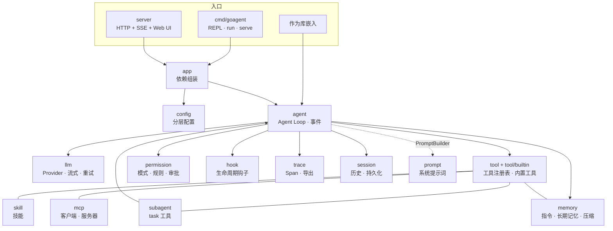
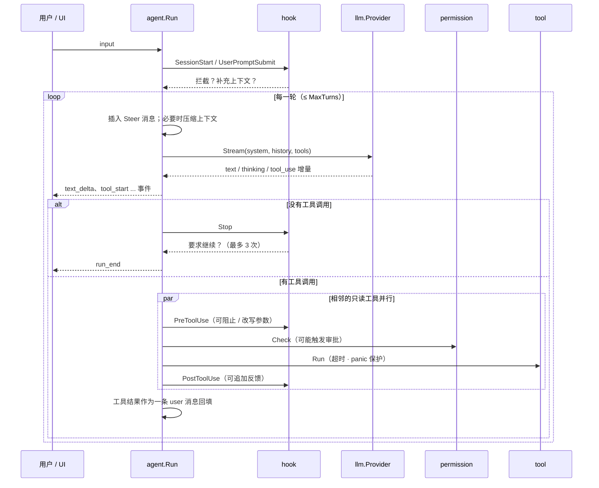

# goagent 架构说明

本文说明 goagent 各模块的职责、数据如何流动、事件模型，以及几个关键的设计取舍。
阅读顺序建议：先看"整体结构"与"一次运行的数据流"，再按需查阅各模块。

## 整体结构



依赖方向是单向的：`agent` 只依赖接口与数据类型（`llm.Provider`、`tool.Tool`、`session.Store`……），
不认识任何具体的模型厂商或工具。`app` 是唯一知道"所有零件"的地方，负责把它们组装起来。

## 模块职责

| 包 | 职责 | 关键类型 |
| --- | --- | --- |
| `llm` | 与模型交互的统一抽象：消息、内容块、工具描述、流式事件；Anthropic 与 OpenAI 兼容协议实现；SSE 解析；重试 | `Provider`、`Message`、`ContentBlock`、`StreamEvent`、`RetryProvider`、`MockProvider` |
| `tool` | 工具接口、注册表、泛型函数工具、反射生成 JSON Schema、文件访问追踪、输出截断 | `Tool`、`Registry`、`Func`、`SchemaOf`、`FileTracker` |
| `tool/builtin` | 内置工具：文件读写编辑、目录、glob、grep、bash、web_fetch、todo_write | `All`、`Options` |
| `agent` | Agent Loop：组装请求 → 流式调用 → 工具执行 → 回填；事件发布；会话级运行状态 | `Agent`、`Event`、`Sink` |
| `permission` | 决定一次工具调用是否允许：模式、规则匹配、人工审批 | `Checker`、`Rule`、`Approver` |
| `hook` | 在生命周期节点执行用户逻辑（Go 函数或 shell 命令） | `Manager`、`Input`、`Output` |
| `session` | 一次多轮对话的状态与持久化（原子写入 JSON 文件） | `Session`、`Store`、`FileStore` |
| `memory` | 三层记忆：项目指令（AGENTS.md）、长期记忆（Markdown 笔记）、上下文压缩 | `LoadInstructions`、`Store`、`Compactor` |
| `skill` | 发现技能目录，提供 `skill` 工具按需加载正文 | `Skill`、`Discover`、`Tool` |
| `subagent` | 子 Agent 定义与 `task` 工具 | `Definition`、`TaskTool`、`Spawn` |
| `mcp` | MCP 客户端（stdio / Streamable HTTP），把远程工具适配为本地工具；极简 MCP 服务器 | `Client`、`Manager`、`Server` |
| `trace` | 树状 Span、内存与 JSONL 导出、终端树形渲染 | `Tracer`、`Span`、`Memory`、`File` |
| `prompt` | 按 Agent 实际拥有的能力拼装系统提示词 | `Builder` |
| `config` | 默认值 → 用户级 → 项目级 → 环境变量的分层配置 | `Config`、`Load` |
| `app` | 依赖注入：根据配置创建并连接所有组件 | `App`、`New` |
| `server` | HTTP API、SSE 推送、Web 审批、内置界面 | `Server`、`WebApprover` |
| `cmd/goagent` | 命令行：REPL、run、serve、trace、sessions、config | — |
| `internal/frontmatter` | 解析 Markdown 头部元数据（替代 YAML 依赖） | `Parse`、`List`、`Render` |
| `internal/procutil` | 跨平台子进程：Unix 进程组终止、Windows 回退 | `Command` |

## 一次运行的数据流



要点：

1. **历史是唯一的事实来源**。每一轮都把完整历史发给模型；模型本身无状态。
2. **工具结果回填为 user 消息**，其中每个 `tool_result` 块通过 `tool_use_id` 对应一次调用。
   OpenAI 协议没有这种块，`llm/openai.go` 在发送前把它们转换成 `role=tool` 消息。
3. **工具层面的失败不是 Go 错误**。参数错误、文件不存在、权限拒绝都以 `IsError=true` 的结果回填，
   模型能看到并自行修正；只有模型调用失败、ctx 取消、超过轮数才会让 `Run` 返回 error。
4. 每次模型调用结束后、以及 `Run` 返回前都会保存会话（`Store.Save`），进程崩溃最多丢失一轮。

## 事件模型

`agent.Run` 通过 `Sink func(Event)` 对外发布事件；CLI 把它渲染到终端，HTTP 服务把它原样序列化为 SSE。
`Event` 是一个扁平结构体，按 `Type` 决定哪些字段有值，这样任何语言的前端都能用一个 `switch` 处理。

典型序列（一次工具调用后回答）：

```
span_start(agent.run) → run_start
turn_start(1) → span_start(llm.call) → text_delta* → tool_start → tool_input_delta* → span_end(llm.call)
  → message → usage → span_start(tool.x) → tool_call → span_end(tool.x) → tool_result
turn_start(2) → span_start(llm.call) → text_delta* → span_end(llm.call) → message → usage
span_end(agent.run) → run_end
```

出错时在 `span_end(agent.run)` 之前多一个 `error` 事件；**`run_end` 无论成功失败都一定是最后一个事件**，
UI 可以依赖它结束"运行中"状态。

设计细节：

- **事件带 Agent 路径**。子 Agent 的事件 `Agent` 字段形如 `main>explore#3`，UI 据此缩进或折叠。
  路径通过 `context` 传递（`withPath`），子 Agent 不需要知道父 Agent 是谁。
- **Sink 放进 context**。审批器、子 Agent 这类深层组件通过 `agent.SinkFrom(ctx)` 发事件，
  而不必层层传参。Web 审批的 `permission_request` 事件就是这样发出的。
- **Sink 调用是串行的**。`Run` 内部用互斥锁保护 Sink，即使并行工具同时发事件，实现方也无需加锁；
  但 Sink 不应阻塞太久，否则会拖慢 Agent。HTTP 服务用带缓冲的 channel 解耦。
- **Trace 与事件是两条线**。事件面向实时 UI，Span 面向事后分析；`span_start` / `span_end` 事件
  把 Span 快照也推给 UI，调试面板可以实时画出调用树。

## 关键设计取舍

### 为什么零依赖

- **教学**：读者能读懂每一行代码，没有"这里调用了某个库，里面发生了什么不用管"。
  SSE 解析、JSON Schema 生成、frontmatter 解析、MCP 协议都只有几十到几百行，正好是很好的练习。
- **供应链与部署**：单个静态二进制，`go install` 即可使用；国内网络环境下不需要折腾依赖下载。
- **代价**：frontmatter 只支持 `key: value` 与简单列表；HTML 转文本是正则实现；没有 OpenTelemetry 导出。
  这些都可以在需要时通过实现接口（如 `trace.Exporter`）在外部补上，而不污染核心。

### 为什么 edit_file 用精确字符串替换

- 与行号补丁或 diff 相比，"把这段原文换成那段"对模型最容易做对：不需要数行号，也不怕前面的编辑让行号失效。
- **唯一性约束**是安全阀：`old_string` 出现多次时直接报错，要求模型提供更多上下文，避免改错地方。
- 比整文件重写省大量输出 token，也不会因为模型"顺手"改写其它代码而引入意外修改。
- 配合 **"先读后改"保护**：修改已存在的文件前必须 `read_file`，且文件在读取后不能被外部修改，
  防止模型凭记忆覆盖用户刚改过的内容。

### 并行工具策略

- 只有 `Info.Concurrent=true` 的工具（只读工具、子 Agent、带 `readOnlyHint` 的 MCP 工具）可以并行。
- 调度按"相邻分组"：连续的可并行调用组成一批并发执行，遇到有副作用的调用就停下来串行执行。
  这样既能并行读取多个文件，又保证"先读 A、再写 A、再读 A"这种依赖顺序不被打乱。
- 并发度受 `MaxParallelTools` 限制（信号量）；结果按原调用顺序回填，与执行完成的先后无关。

### 上下文压缩的切分点

- 触发条件：估算 token（或上一次请求实际的输入 token，取较大者）超过 `ContextWindow × Threshold`。
- **切分点必须落在用户的文字输入上**。如果切在 `tool_use` 与 `tool_result` 之间，保留部分会出现
  "没有对应调用的结果"，所有主流 API 都会直接拒绝请求。用户输入是天然的安全边界。
- 保留最近 `KeepRecent` 轮用户输入及其之后的全部消息原样不动，更早的部分交给模型生成结构化摘要，
  以"摘要（user）+ 确认（assistant）"两条消息放回历史开头，保持 user/assistant 交替。
- 之前的摘要会和新内容一起再次压缩，因此多次压缩后信息不会断档。
- token 估算是粗略的（英文约 4 字符 / token，中文约 1.5 字符 / token），只用于决定"何时压缩"。

### 权限判定顺序

`deny 规则 > plan 模式 > ask 规则 > allow 规则 > 本会话记住 > 模式默认`。
deny 永远优先，`bypass` 模式下 deny 也有效；plan 模式下即使配置了 allow 也不能执行有副作用的工具。
"记住"只按工具名记录，粒度粗但不会让模型绕过 ask 规则。

### 系统提示词按能力生成

`prompt.Builder.Build(a)` 接收具体的 Agent，只描述它真正拥有的工具：
子 Agent 的工具集经过过滤，没有 `task` 工具时提示词里就不会出现子 Agent 清单。
输出必须是确定的（MCP 说明按名称排序），否则每次请求的系统提示词都不同，无法命中模型的提示词缓存。

### 子 Agent 隔离

- 子 Agent 拥有全新的会话，父 Agent 只拿到它的最终汇报，大量探索过程不会挤占主上下文。
- 子 Agent 的工具集中移除了 `task`，避免无限递归委派。
- 共享 Provider、权限、钩子与 Tracer：权限规则对子 Agent 同样生效，Span 自动挂在父 Agent 的 `tool.task` 之下。

### 重试只在"尚未输出"时进行

`RetryProvider` 一旦向上游发出过任何流式事件就不再重试，否则用户会看到重复的文字。
限流（429）、过载（529）、5xx、网络抖动会重试；参数错误、鉴权失败立即返回。

### 子进程管理

`bash` 工具与命令钩子在独立进程组中运行，超时或取消时向整个进程组发送 SIGKILL，
`go test`、`npm run` 派生的子进程不会变成孤儿。`WaitDelay` 防止后台进程占住输出管道导致永久阻塞。
Windows 没有进程组语义，`internal/procutil` 中退化为只结束主进程。

## 扩展点一览

| 想要…… | 做法 |
| --- | --- |
| 接入新的模型厂商 | 实现 `llm.Provider`，在 `llm.NewProvider` 注册 |
| 添加工具 | `tool.Func` 定义后 `Registry.Register`，或通过 `app.Options.ExtraTools` 注入 |
| 自定义审批界面 | 实现 `permission.Approver` |
| 拦截 / 改写工具调用 | `hook.Manager.On(hook.PreToolUse, ...)` |
| 换会话存储（数据库） | 实现 `session.Store` |
| 导出 Trace 到其它系统 | 实现 `trace.Exporter` |
| 自定义系统提示词 | 实现 `agent.PromptBuilder`，或设置 `prompt.Builder.Identity` / `Extra` |
